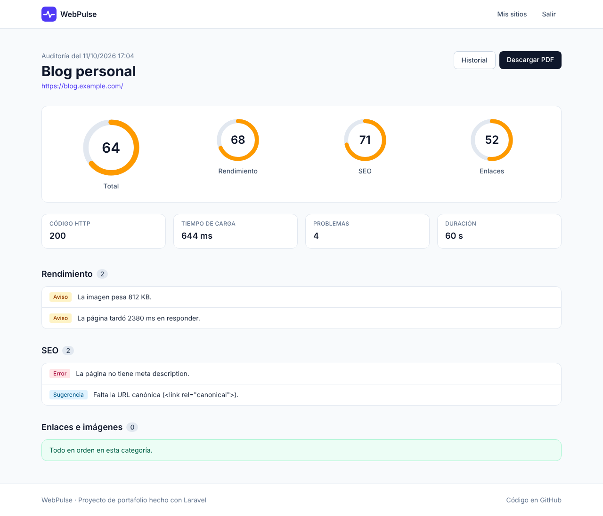
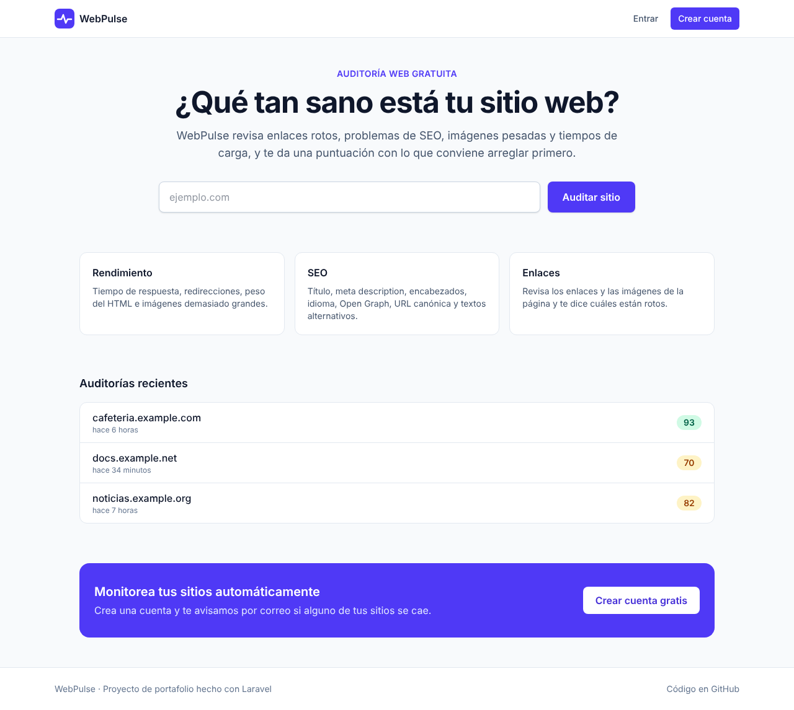
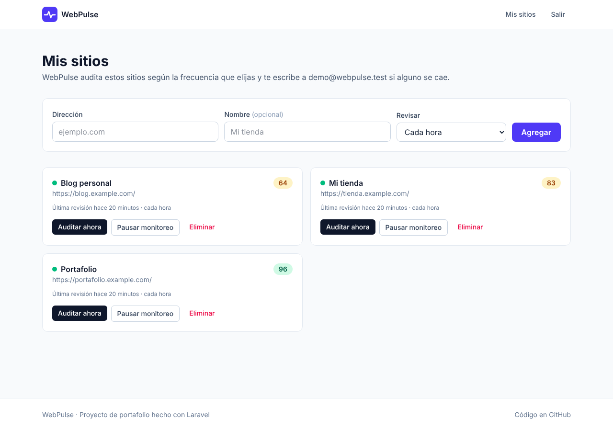
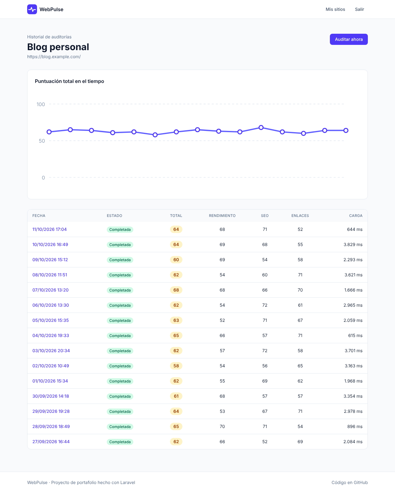

# WebPulse

[](https://github.com/ingsivan/webpulse/actions/workflows/tests.yml)


**Monitor y auditor de sitios web.** Escribes una dirección y WebPulse revisa enlaces rotos, problemas de SEO, imágenes pesadas y tiempos de carga. Te da una puntuación de 0 a 100 por categoría, guarda el historial y, si creas una cuenta, vigila tus sitios y te escribe cuando alguno se cae.



> **Demo:** <https://webpulse-sf4g.onrender.com> (entra con **demo@webpulse.test** / **password**). Está en el plan gratis de Render: la primera visita tras un rato sin uso puede tardar unos 50 segundos.

## Funciones

- **Auditoría al instante, sin cuenta.** Se ejecuta en segundo plano y la página muestra el progreso en vivo.
- **Tres categorías con puntuación:**
  - *Rendimiento:* tiempo de respuesta, redirecciones en cadena, peso del HTML e imágenes de más de 300 KB.
  - *SEO:* `<title>`, meta description, `<h1>`, idioma, Open Graph, URL canónica y textos alternativos.
  - *Enlaces e imágenes:* prueba hasta 25 enlaces y 15 imágenes y reporta los rotos.
- **Historial por sitio** con gráfico de la puntuación en el tiempo (SVG, sin librerías).
- **Cuentas y monitoreo:** hasta 10 sitios por usuario, revisados cada 15 minutos a una vez al día.
- **Alertas por correo** cuando un sitio se cae y cuando vuelve, sin repetir avisos.
- **Reporte imprimible** listo para guardar como PDF desde el navegador.
- **Protección contra SSRF:** nunca hace peticiones a redes internas, aunque llegue a ellas por una redirección o un cambio de DNS.

| Inicio | Panel | Historial |
|--------|-------|-----------|
|  |  |  |

## Stack

| Capa | Tecnología |
|------|------------|
| Backend | Laravel 13, PHP 8.3 |
| Frontend | Blade, Tailwind CSS 4, Vite y un poco de JavaScript sin frameworks |
| Base de datos | SQLite en local y en la demo; MySQL o PostgreSQL en producción |
| Trabajo en segundo plano | Colas y Scheduler de Laravel (driver `database`) |
| Pruebas | PHPUnit (85 tests), Pint |
| CI/CD | GitHub Actions, Docker, Render |

No usa dependencias de terceros más allá de Laravel: el análisis de HTML usa el DOM nativo de PHP y los gráficos son SVG generados en el servidor.

## Ejecutar en local

Necesitas PHP 8.3+, Composer y Node 22+.

```bash
git clone https://github.com/ingsivan/webpulse.git
cd webpulse
cp .env.example .env
touch database/database.sqlite
composer setup              # instala dependencias, genera la clave, migra y compila assets
php artisan db:seed         # datos de demostración (opcional)
composer run dev            # servidor, cola y Vite a la vez
```

Abre <http://localhost:8000>. Con los datos de demostración puedes entrar como **demo@webpulse.test** con la contraseña **password**.

Para que el monitoreo programado funcione en local, deja corriendo también:

```bash
php artisan schedule:work
```

Los correos se escriben en `storage/logs/laravel.log` (`MAIL_MAILER=log`).

## Pruebas

```bash
php artisan test        # 85 tests, sin acceso a la red
vendor/bin/pint --test  # estilo de código
```

Los tests simulan las respuestas HTTP y el DNS, así que nunca salen a internet. CI los corre en PHP 8.3, 8.4 y 8.5, y además construye la imagen Docker y comprueba que arranca.

## Documentación

- [Arquitectura](docs/arquitectura.md): cómo fluye una auditoría, modelo de datos y cálculo de puntuaciones.
- [Seguridad](docs/seguridad.md): SSRF, límites de uso, permisos y otras defensas.
- [Despliegue](docs/despliegue.md): Docker, Render y variables de entorno.

## Hoja de ruta

- [x] Modelos `Site`, `Audit` y `AuditIssue`
- [x] Auditor con protección contra SSRF
- [x] Auditorías en cola con progreso en vivo
- [x] Dashboard con puntuaciones e historial
- [x] Monitoreo programado con alertas por correo
- [x] Reporte PDF
- [x] CI con GitHub Actions y Docker
- [x] Publicar la demo
- [ ] Auditar varias páginas por sitio (crawler)
- [ ] Métricas de Core Web Vitals con un navegador real

## Créditos

Construido por [@ingsivan](https://github.com/ingsivan) con ayuda de Claude. El diseño, las decisiones y las pruebas son míos.
