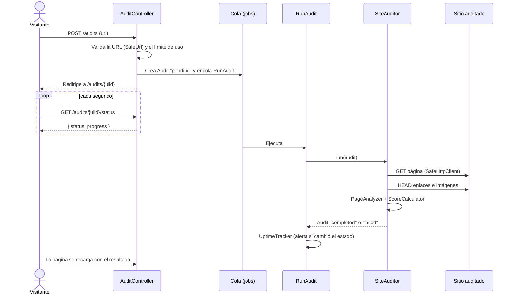
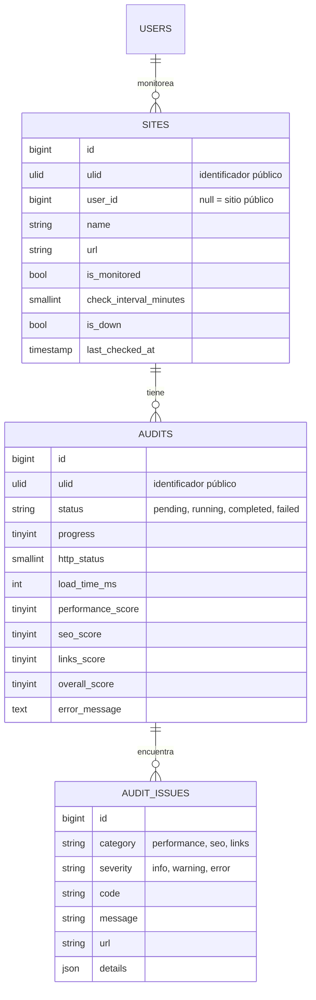

# Arquitectura

WebPulse es una aplicación Laravel monolítica. Las páginas se renderizan en el servidor con Blade y el único JavaScript es el que consulta el progreso de una auditoría.

## Flujo de una auditoría

## Piezas principales

| Clase | Responsabilidad |
|-------|-----------------|
| `App\Services\Audit\SiteAuditor` | Orquesta la auditoría: descarga la página, revisa rendimiento, analiza el HTML, prueba enlaces e imágenes, guarda los problemas y las puntuaciones. Reporta el progreso (0–100) mientras avanza. |
| `App\Services\Audit\SafeHttpClient` | Cliente HTTP para URLs que escriben los usuarios. Valida cada salto de redirección y fija la conexión a la IP comprobada. Ver [seguridad](seguridad.md). |
| `App\Services\Audit\HostResolver` | Resuelve un dominio a sus IPs (IPv4 e IPv6). En los tests se reemplaza por un DNS falso. |
| `App\Services\Audit\PageAnalyzer` | Lee el HTML con el DOM nativo de PHP y devuelve problemas de SEO, enlaces e imágenes. No hace peticiones. |
| `App\Services\Audit\UrlResolver` | Convierte enlaces relativos en absolutos siguiendo el RFC 3986, respetando `<base href>`. |
| `App\Services\Audit\ScoreCalculator` | Convierte los problemas en puntuaciones. |
| `App\Services\Audit\UptimeTracker` | Detecta cuándo un sitio monitoreado se cae o se recupera y avisa al dueño una sola vez por cambio. |
| `App\Jobs\RunAudit` | Ejecuta una auditoría en la cola. No se reintenta, para no duplicar problemas. |
| `App\Console\Commands\MonitorSites` | `webpulse:monitor`, programado cada 5 minutos: encola auditorías de los sitios cuyo intervalo ya pasó. |

## Modelo de datos

- Las URLs públicas usan el `ulid` y no el `id`, así no se pueden recorrer auditorías ajenas cambiando un número.
- Un sitio sin `user_id` es público: lo crea el formulario de inicio y cualquiera puede ver sus auditorías. Las direcciones se normalizan (`Example.com` y `https://example.com/` son el mismo sitio) para que compartan historial.

## Puntuaciones

Cada categoría empieza en 100 y resta por cada problema encontrado:

| Severidad | Resta |
|-----------|-------|
| Error | 25 |
| Aviso | 10 |
| Sugerencia | 2 |

La puntuación total es el promedio redondeado de las tres categorías. Los colores de la interfaz siguen el criterio de Lighthouse: verde desde 90, ámbar desde 50 y rojo por debajo.

## Revisiones

| Código | Categoría | Severidad | Cuándo |
|--------|-----------|-----------|--------|
| `very_slow_page` / `slow_page` | Rendimiento | Error / Aviso | La página tarda 4 s o 2 s o más |
| `redirect_chain` | Rendimiento | Aviso | Más de una redirección antes de cargar |
| `heavy_html` | Rendimiento | Aviso | El HTML pesa más de 500 KB |
| `heavy_image` | Rendimiento | Aviso | Una imagen pesa más de 300 KB (`Content-Length`) |
| `page_unavailable` | Rendimiento | Error | La página responde con 4xx o 5xx |
| `missing_title` / `long_title` | SEO | Error / Aviso | Sin `<title>` o con más de 60 caracteres |
| `missing_meta_description` / `meta_description_length` | SEO | Error / Aviso | Sin descripción o fuera de 50–160 caracteres |
| `missing_h1` / `multiple_h1` | SEO | Error / Aviso | Ningún `<h1>` o más de uno |
| `missing_lang` | SEO | Aviso | `<html>` sin atributo `lang` |
| `images_missing_alt` | SEO | Aviso | Imágenes sin `alt` |
| `missing_og_title` / `missing_canonical` | SEO | Sugerencia | Sin `og:title` o sin URL canónica |
| `broken_link` / `broken_image` | Enlaces | Error | Responden con 4xx o 5xx |
| `unreachable_link` / `unreachable_image` | Enlaces | Aviso | No se pueden abrir o apuntan a una red interna |

Los límites (enlaces e imágenes revisados, umbrales y timeouts) están en `config/webpulse.php`.
